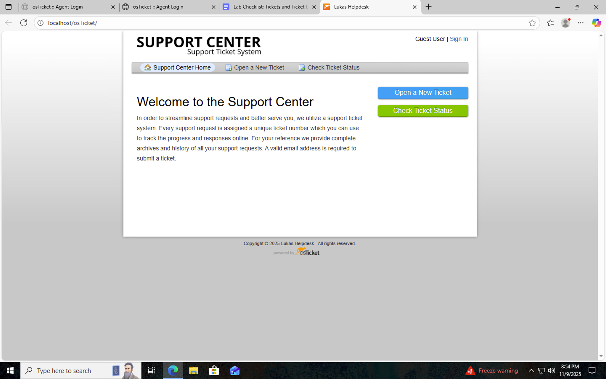
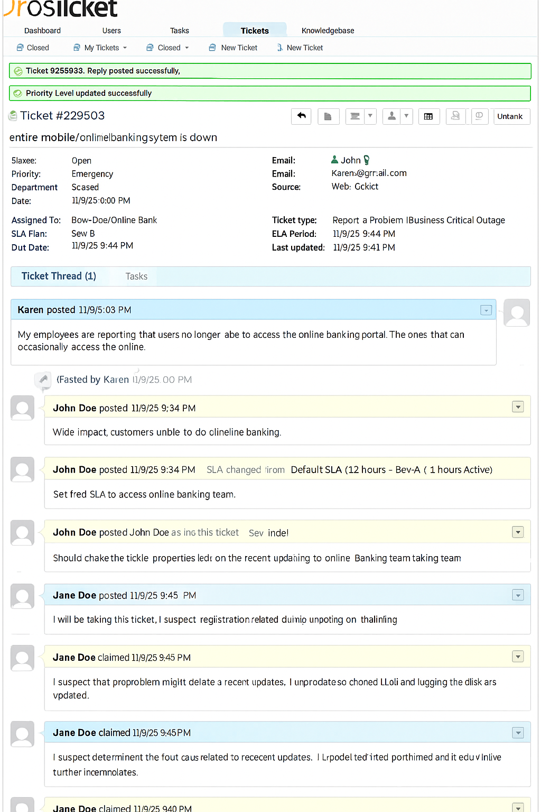
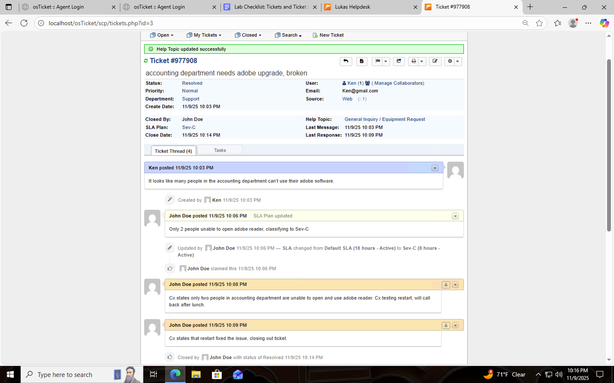
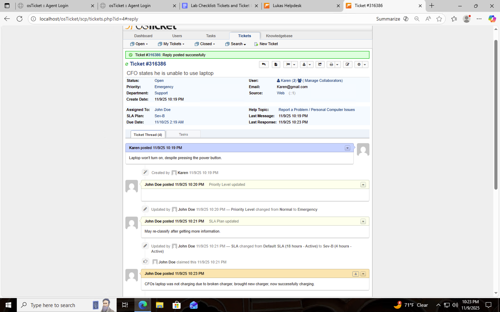

# osTicket Help Desk Lab — Ticket Lifecycle

> **Portfolio lab:** Personal training environment; not a production system.

## Overview

The third stage of the osTicket lab: simulated user requests are received, classified, assigned, escalated, worked, and closed. Scenarios include a banking outage, a software upgrade problem, and a laptop that will not power on.

## Tools and technologies

osTicket 1.15.8, Windows 10, Microsoft Azure, IIS, RDP

## What I did

1. Submit example requests through the end-user portal.
2. Review ticket properties, department assignment, severity, and SLA.
3. Work or escalate tickets under different agent accounts.
4. Document completion and close simulated tickets.

## Selected evidence

### End-user ticket intake

### Ticket handling

## What I learned

The scenarios illustrated the importance of prioritization, clear ownership, and documentation during incident handling. These were simulated tickets, not customer incidents.

## Related work

[Installation](https://github.com/lukasparmelee/osTicket-prereqs) · [Post-install configuration](https://github.com/lukasparmelee/post-install-config) · [Ticket lifecycle](https://github.com/lukasparmelee/Ticket-lifecycle)

## Security and scope

Screenshots and instructions describe a controlled learning lab. Do not reuse demonstration credentials, expose live secrets, or reproduce permissive firewall settings in production. Verify screenshots and repository history contain no active credentials before publishing.

